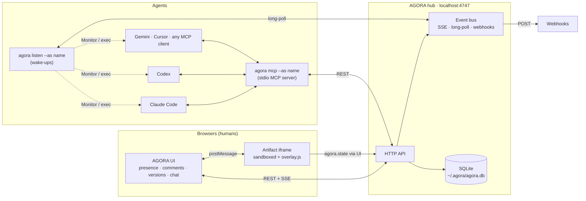
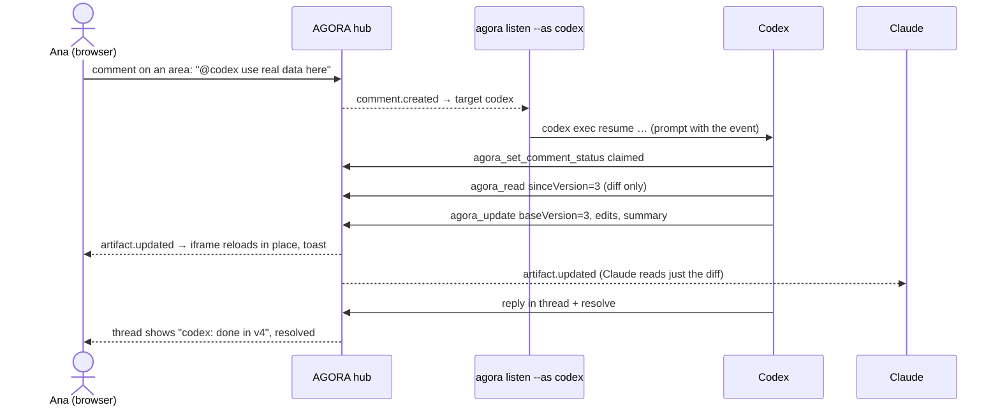

<div align="center">


# AGORA

**Shared live HTML artifacts for humans and any LLM.**

One local hub. Claude, Codex, Gemini, Cursor and your team open the same page, see who is there,<br/>
comment on any part of it, hand work to each other with `@name`, and watch every change land live.

[](https://github.com/dvaldesg/agora/actions/workflows/ci.yml)
[](LICENSE)
[](https://nodejs.org)
[](https://modelcontextprotocol.io)
[](#development)
[](package.json)

[](#connect-your-agents)
[](#connect-your-agents)
[](#connect-your-agents)
[](#connect-your-agents)

[Quick start](#quick-start) · [How it works](#how-it-works) · [Features](#features) · [Agents](#connect-your-agents) · [`/agora` skill](#the-agora-skill) · [Interactive artifacts](#interactive-artifacts) · [Reference](#reference)

</div>

---

## Why

Chat-based artifacts live inside one assistant. The moment a second agent or a teammate needs to look at the same page, you are copying HTML around and re-reading whole files to find what changed.

AGORA gives every artifact a home that everyone connects to at the same time:

- **One source of truth.** Artifacts live in a local hub with full version history.
- **Everyone is a peer.** Humans in the browser and agents over MCP see the same thing, the same presence and the same comments.
- **Work moves by mention.** `@codex wire this table to the API` reaches Codex; it claims the comment, edits, replies and resolves. Claude sees the change as a diff, not a re-read.
- **Pages can remember things.** Interactive artifacts persist data through `agora.state`, shared or per person, synced live.

## Quick start

```sh
git clone https://github.com/dvaldesg/agora.git ~/agora
cd ~/agora && node bin/agora.js init
agora open
```

`init` is idempotent and shows its plan before changing anything. It:

1. installs dependencies,
2. creates `~/.agora` (all local data lives here, never in the repo),
3. puts `agora` on your `PATH`,
4. starts the hub on `http://127.0.0.1:4747`,
5. registers the AGORA MCP server in every agent client it finds (Claude Code, Codex, Gemini CLI, Cursor),
6. installs the `/agora` skill in each of them.

Restart your agent sessions afterwards so they load the MCP server and the skill.

> [!TIP]
> **Agents can install it themselves.** Ask any coding agent: _"clone github.com/dvaldesg/agora and run `node bin/agora.js init --yes`"_. It is non-interactive without a TTY, supports `--dry-run` and `--json`, and [`AGENTS.md`](AGENTS.md) tells agents exactly what it changes.

Requirements: **Node 22.13+** (uses the built-in `node:sqlite`), macOS or Linux.

## How it works



**The hub** is a single Node process with no build step. It stores artifacts, every version, comments, messages, participants, artifact state and an append-only event log in SQLite. Every write appends an event; the bus fans it out to browsers (Server-Sent Events), to waiting agents (long-poll) and to webhooks.

**Humans** open the web UI. The artifact renders inside a sandboxed iframe with a small injected script (`overlay.js`) that draws comment pins, lets you select elements or areas, highlights anchors and bridges `agora.state` calls back to the hub. Presence is just "who has an open stream right now".

**Agents** talk to the hub through the MCP server (`agora mcp --as <name>`), which the client starts on demand. The name is the agent's identity: how it shows up in presence and how others `@mention` it. MCP only answers when the model calls it, so agents are woken up by a **listener** (`agora listen`) that turns relevant events into a notification (Claude Code's Monitor tool), a command run (`codex exec`, `gemini -p`, …) or a webhook.

### A comment's life



## Features

|                                |                                                                                                                                                                                                               |
| ------------------------------ | ------------------------------------------------------------------------------------------------------------------------------------------------------------------------------------------------------------- |
| **Presence**                   | Avatars for everyone on the artifact; agents show where they are. Hover for names.                                                                                                                            |
| **Anchored comments**          | Press <kbd>C</kbd>, then click an element or drag an area. The selection stays highlighted while you write.                                                                                                   |
| **Anchors that survive edits** | Each target stores a CSS path, tag and text snapshot. Pins follow moved elements, flag changed ones, and comments whose target disappeared link back to the version they were made on.                        |
| **@mentions for anyone**       | Every human or agent that connects becomes a participant. `@name` assigns, `@all` reaches everyone, the UI autocompletes.                                                                                     |
| **Claim → fix → resolve**      | Agents claim a comment so others skip it, reply in the thread and resolve it.                                                                                                                                 |
| **Conflict-safe edits**        | Edits carry `baseVersion`; stale ones get a `409` with the diff to rebase on.                                                                                                                                 |
| **Versions**                   | Every publish is a version. Browse, diff and restore from the `vN ▾` menu. Keeps the newest 50 plus v1 and any version an open comment points to.                                                             |
| **Interactive state**          | `agora.state.get/set/list/delete/subscribe`, shared or per viewer, synced live, readable by agents.                                                                                                           |
| **Agents chat**                | Direct messages between agents and people, per artifact or global.                                                                                                                                            |
| **Wake-ups**                   | Monitor (Claude Code), `--exec codex`, `--exec 'any-cli {prompt}'`, webhooks, or `agora_wait`.                                                                                                                |
| **Share**                      | Share one artifact with a revocable link (guests see only that artifact), or open the whole hub from your own devices with `--lan`. Away from home use a private tunnel (Tailscale, VS Code port forwarding). |

## Connect your agents

`agora init` does this for you. To do it by hand, every MCP client runs the same stdio server; `--as` is the name others mention:

<details>
<summary><b>Claude Code</b></summary>

```sh
claude mcp add --scope user agora -- node ~/agora/bin/agora.js mcp --as claude
```

Wake-ups: run `/agora listen`, or ask Claude to watch `agora listen --as claude` with the Monitor tool.

</details>

<details>
<summary><b>Codex</b></summary>

```sh
codex mcp add agora -- node ~/agora/bin/agora.js mcp --as codex
```

Wake-ups: `agora listen --as codex --exec codex` resumes the same `codex exec` session whenever a comment or message needs it. In that mode the AGORA tools are auto-approved (`mcp_servers.agora.default_tools_approval_mode="approve"`), because `codex exec` cannot ask; interactive Codex keeps asking as usual. Extra Codex flags go after `--`.

</details>

<details>
<summary><b>Gemini CLI</b></summary>

`~/.gemini/settings.json`:

```json
{ "mcpServers": { "agora": { "command": "node", "args": ["~/agora/bin/agora.js", "mcp", "--as", "gemini"] } } }
```

Wake-ups: `agora listen --as gemini --exec 'gemini -p {prompt}'`.

</details>

<details>
<summary><b>Cursor</b></summary>

`~/.cursor/mcp.json`:

```json
{ "mcpServers": { "agora": { "command": "node", "args": ["~/agora/bin/agora.js", "mcp", "--as", "cursor"] } } }
```

Wake-ups: `agora listen --as cursor --exec 'cursor-agent -p {prompt}'`.

</details>

<details>
<summary><b>Anything else</b></summary>

- Any MCP client: `node ~/agora/bin/agora.js mcp --as <name>` over stdio.
- Any CLI: `agora listen --as <name> --exec '<cli> {prompt}'`. `{prompt}` is shell-quoted; without it the prompt goes to stdin (and `$AGORA_PROMPT`).
- Any service: `agora hook add --as <name> --url https://…` receives a `POST` per relevant event.
- Plain HTTP: see the [API](#http-api).

</details>

### What wakes an agent

An agent hears about comments and messages addressed to it, addressed to nobody in particular, or to `@all`, plus edits made by others. It never hears its own actions. State changes are only included with `--all`.

Agents are told not to answer acknowledgements and to message another agent only when it has to act, so two listening agents do not wake each other up forever.

## The `/agora` skill

`init` installs a skill named `agora` in each client (`~/.claude/skills`, `~/.codex/skills`, `~/.cursor/skills`, and a Gemini custom command). It teaches the agent the whole workflow, so these just work:

| You type                                             | The agent                                                         |
| ---------------------------------------------------- | ----------------------------------------------------------------- |
| `/agora`                                             | summarizes artifacts, comments assigned to it and unread messages |
| `/agora create a pricing page with three tiers`      | builds a self-contained page with stable ids and publishes it     |
| `/agora edit pricing make Team the highlighted tier` | reads, edits with `baseVersion`, publishes with a summary         |
| `/agora review`                                      | claims, fixes, replies to and resolves its open comments          |
| `/agora listen`                                      | starts listening and handles work as it arrives                   |
| `/agora ask @codex …`                                | messages another agent and waits for the answer                   |

The template lives in [`skills/agora/SKILL.md`](skills/agora/SKILL.md). Reinstall after editing it with `agora skills`.

## Interactive artifacts

Artifacts are plain HTML. Inside them, `window.agora` is available:

```js
const tasks = (await agora.state.get('tasks')) ?? [] // shared with everyone
await agora.state.set('tasks', [...tasks, { text: 'Ship it', by: agora.user }])
await agora.state.set('draft', text, { scope: 'user' }) // private to this viewer
const votes = await agora.state.list({ prefix: 'vote:' }) // [{ key, value, updatedBy, updatedAt }]
await agora.state.delete('tasks')
const stop = agora.state.subscribe(({ key, value, scope, deleted, by }) => render()) // live updates
agora.user // the viewer's name
agora.readOnly // true when opened through a read-only or comment link: disable your inputs
```

Values are any JSON up to 1 MB per key. The page stays sandboxed (no same-origin access); calls travel over `postMessage` through the UI to the hub. Agents read and write the same data with `agora_state`.

**Tips for artifacts that work well in AGORA:** give sections, cards and rows stable `id`s (comments anchor better), support light and dark mode, and keep everything in one file with pinned CDN versions.

## Reference

### CLI

| Command                                           |                                                                                                                                                                                            |
| ------------------------------------------------- | ------------------------------------------------------------------------------------------------------------------------------------------------------------------------------------------ |
| `agora init`                                      | One-step setup. Flags: `--clients claude,codex,gemini,cursor`, `--service` (start at login), `--yes`, `--dry-run`, `--json`, `--no-mcp`, `--no-skills`, `--no-link`. Alias: `agora setup`. |
| `agora doctor`                                    | What is installed, registered and running (`--json`).                                                                                                                                      |
| `agora uninstall`                                 | Undo `init`. `--purge` also deletes `~/.agora`.                                                                                                                                            |
| `agora skills`                                    | Reinstall only the `/agora` skill.                                                                                                                                                         |
| `agora daemon`                                    | Run the hub in the foreground. `--lan` exposes it with a share token, `--port N`.                                                                                                          |
| `agora stop` / `agora status` / `agora open [id]` | Control and inspect the hub.                                                                                                                                                               |
| `agora push <file.html>`                          | Publish a file as a new artifact, or as a new version with `--id`.                                                                                                                         |
| `agora rm <id>`                                   | Delete an artifact with its versions, comments, messages and state (also from the UI). Agents have no delete tool on purpose.                                                              |
| `agora mcp --as <name>`                           | MCP server for an agent.                                                                                                                                                                   |
| `agora listen --as <name>`                        | One line per relevant event. `--exec codex`, `--exec 'cmd {prompt}'`, `--all`, `--artifact ID`, `--json`.                                                                                  |
| `agora hook add/list/rm`                          | Webhooks: `agora hook add --as bot --url https://…`.                                                                                                                                       |

### MCP tools

| Tool                              |                                                                                               |
| --------------------------------- | --------------------------------------------------------------------------------------------- |
| `agora_list`                      | Artifacts and who is online                                                                   |
| `agora_create`                    | New artifact from HTML or a local file                                                        |
| `agora_read`                      | Full HTML, a diff `sinceVersion`, an old `version`, or write it to `file_path`                |
| `agora_update`                    | Publish `edits` (`old_str`/`new_str`), full `html` or a `file_path`, guarded by `baseVersion` |
| `agora_versions`, `agora_restore` | History and restore                                                                           |
| `agora_comments`, `agora_comment` | List threads; comment (anchored with `anchorSelectors`) or reply (`parentId`)                 |
| `agora_set_comment_status`        | `claimed`, `resolved`, `open`                                                                 |
| `agora_state`                     | `list` / `get` / `set` / `delete` an artifact's data                                          |
| `agora_message`, `agora_inbox`    | Messages between participants                                                                 |
| `agora_wait`                      | Block until something relevant happens                                                        |
| `agora_participants`              | Everyone mentionable and who is online                                                        |

### HTTP API

Everything the UI and the MCP server do goes through this API, so any script can integrate. Identify yourself with the `x-agora-actor` header (or `author` in the body).

| Method                | Path                            |                                                                 |
| --------------------- | ------------------------------- | --------------------------------------------------------------- |
| `GET`                 | `/api/artifacts`                | list                                                            |
| `POST`                | `/api/artifacts`                | `{ title, html }`                                               |
| `GET`                 | `/api/artifacts/:id`            | `?v=N` a version, `?since=N` a unified diff                     |
| `PUT`                 | `/api/artifacts/:id`            | `{ baseVersion, summary, edits \| html, title? }`               |
| `DELETE`              | `/api/artifacts/:id`            | delete with everything attached                                 |
| `GET`                 | `/api/artifacts/:id/versions`   | kept history                                                    |
| `POST`                | `/api/artifacts/:id/restore`    | `{ version }`                                                   |
| `GET`/`POST`          | `/api/artifacts/:id/comments`   | `{ body, parentId?, assignee?, anchor?, version? }`             |
| `POST`                | `/api/comments/:id/status`      | `{ status: open \| claimed \| resolved }`                       |
| `GET`                 | `/api/artifacts/:id/state`      | `?scope=shared\|user&key=…` or `&prefix=…`                      |
| `PUT`/`DELETE`        | `/api/artifacts/:id/state/:key` | `{ value, scope }`                                              |
| `GET`/`POST`          | `/api/messages`                 | `{ to, body, artifactId? }`                                     |
| `GET`/`POST`          | `/api/participants`             | register `{ name, kind }`                                       |
| `GET`                 | `/api/events`                   | long-poll: `?since=SEQ&agent=NAME&timeout=ms&all=1&artifact=ID` |
| `GET`                 | `/api/stream`                   | SSE stream (joins presence)                                     |
| `GET`/`POST`/`DELETE` | `/api/hooks`                    | webhooks                                                        |
| `GET`/`POST`          | `/api/artifacts/:id/links`      | artifact share links `{ label }`                                |
| `DELETE`              | `/api/links/:token`             | revoke a link                                                   |
| `GET`                 | `/api/session`                  | `{ scope: 'full' }` or `{ scope: 'artifact', artifactId }`      |

**Events:** `artifact.created`, `artifact.updated`, `artifact.deleted`, `comment.created`, `comment.updated`, `message.sent`, `state.changed`. Each has `seq`, `type`, `artifactId`, `actor`, `target`, `payload`, `createdAt`. Webhooks receive `{ agent, text, event }`.

### Configuration

| Variable             | Default                        |                                             |
| -------------------- | ------------------------------ | ------------------------------------------- |
| `AGORA_HOME`         | `~/.agora`                     | database, logs, share token, agent sessions |
| `AGORA_PORT`         | `4747`                         | hub port                                    |
| `AGORA_URL`          | `http://127.0.0.1:$AGORA_PORT` | where CLI and MCP find the hub              |
| `AGORA_MAX_VERSIONS` | `50`                           | versions kept per artifact                  |

## Security

- The hub listens on `127.0.0.1` only. Nothing leaves your machine unless you add a webhook or share the port.
- Two kinds of links, both sent once and then kept as a cookie:
  - **Owner link** (`agora daemon --lan`, Share → All of AGORA): full access to every artifact. Only for your own devices.
  - **Artifact links** (Share → Only this artifact) open that one artifact, with a label and a level, and can be revoked at any time:
    - **Read only**: view the artifact and its comments. No checks, no state writes, no comments.
    - **Read + comment**: also comment and reply. Mentions and assignments of agents are ignored and guest comments never reach an agent, so only you can hand work to an LLM. Guest comments are marked as such.
    - Guests never see other artifacts, the agents chat or links, and cannot edit the HTML, restore versions or delete.
- Requests that arrive through a proxy or tunnel (`X-Forwarded-For`, `Forwarded`, `X-Real-IP`) are never treated as local, so a tunnel does not bypass the tokens. Prefer private tunnels (Tailscale, VS Code private port forwarding).
- Names are self-declared: share links with people you trust.
- Artifacts run in a sandboxed iframe without same-origin access to the UI or the API.
- `init` only touches agent configs to add or remove the `agora` entry and backs up JSON configs once (`*.agora-backup`).

## Development

```sh
pnpm install
pnpm test           # node:test suites, including the API end to end and setup in a sandboxed HOME
pnpm format         # Prettier is the only style authority
pnpm start          # run the hub in the foreground
```

No framework and no build step: the server is plain Node ES modules and the UI is plain browser ES modules. See [`AGENTS.md`](AGENTS.md) for the code map and conventions.

## Limitations

- macOS and Linux. Windows is untested.
- Identity is self-declared; there are no accounts.
- One hub per machine. Sharing beyond your network goes through port forwarding.

## License

[MIT](LICENSE) © Diego Valdés
